# Petzy

A pet health diary. Petzy is a Progressive Web App that installs on a phone, with a Flask API and MongoDB behind it. Feeding, weight, litter, eye drops and any kind of event the family adds, medication courses with doses, stock and reminders, documents and scans: all of it shared by everyone who looks after the pet.

- Live service: https://petzy.duckdns.org
- API reference: https://petzy.duckdns.org/api/docs

[](https://opensource.org/license/mit)
[](https://github.com/aa-blinov/petzy/actions/workflows/ci.yaml)

---

## Quick start

The shortest path needs neither MongoDB nor Docker. The API runs on an in-memory database, the app on a Vite dev server.

```sh
python3.12 -m venv .venv
.venv/bin/pip install -r requirements-dev.txt
.venv/bin/python scripts/dev_local.py        # API on http://localhost:5001

cd frontend && npm install && npm run dev    # app on http://localhost:5173
```

`scripts/dev_local.py` seeds demo pets and two months of history and keeps outgoing mail in memory. Sign in as `admin` with the password the script sets, which only the local runner accepts. The Vite dev server proxies `/api` to port 5001.

| What you want | Command | Where it runs |
| --- | --- | --- |
| Work on the code | `scripts/dev_local.py` and `npm run dev` | API on 5001, app on 5173 |
| The whole stack with demo data | `docker compose -p petzy-local -f docker-compose.yml -f docker-compose.local.yml up -d --build` | app on 3000 |
| The production stack | `cp .env.example .env`, fill it in, then `docker compose up -d --build` | app on 3000 |

The local stack repeats the production setup on one machine: the same nginx, the same headers, the same build, gunicorn and the reminders service.

```sh
docker compose -p petzy-local -f docker-compose.yml -f docker-compose.local.yml up -d --build
.venv/bin/python scripts/seed_demo.py    # accounts, pets, two months of records
.venv/bin/python scripts/seed_medical.py  # medical card: full for Рекс, partial for Мурзик, empty for Пустик
```

Open http://localhost:3000 and sign in as `demo` (the owner) or `family` (invited to one pet). The password sits in `DEMO_PASSWORD` in `scripts/seed_demo.py`. The seeder fills two pets with photos, two months of records, one custom event type, medicines with stock and doses, documents (one of them expiring soon), one pending and one accepted invitation, and a confirmed mailbox.

`docker-compose.local.yml` keeps this apart from production on purpose: files go to a local S3 server (Versity Gateway) in its own volume, there is no backup service (it would rotate the real bucket's backups), and letters stay in memory at http://localhost:3000/api/dev/outbox. Large scans cannot be uploaded there. Stop it with `docker compose -p petzy-local down`, and with `-v` to wipe the data before seeding again.

In production the host runs nginx, which terminates TLS and proxies everything to `127.0.0.1:3000`. The security headers, the real client address and the Secure flag on the cookie come from `nginx/nginx.conf`.

## What it does

- **Records.** A catalogue of 34 built-in events in groups (feeding, weight, litter with the kind of filler, temperature, water intake, vomiting, walks, water parameters, terrarium climate and others), plus your own event types with their own fields, which the family that created them sees. A feed, a history with filters and trend charts, notifications about unusual values, export to CSV, TSV, HTML, Markdown or a ZIP with everything at once. A record removed by a swipe disappears at once and stays undoable for six seconds.
- **Medicines.** Courses with a schedule, start and end dates, the reason and the doctor (a finished course stays in the medical card with its doses), the nearest dose today on the feed ("Gave it now", "Gave it on time, at 08:00", "Skip the dose"), a dose time you can correct, stock counted down and told when to buy more, and the cancelling of a dose marked by mistake.
- **Documents.** Photos and PDFs up to 10 MB, scans and archives up to 500 MB go straight to object storage, with a reminder when the term ends. The quota is 2 GB per pet owner.
- **Medical card.** A pet's page for the vet, assembled on the fly from its records: allergies (including "no allergies"), chronic conditions, chip and blood type, clinics and doctors with their specialties (several of each), food, living conditions, "For the appointment" (the complaint and what changed, which the vet sees first), vaccinations with their terms, medication courses, parasite treatments, visits, operations, weight, the latest test results. Vaccinations, treatments, visits and operations go in as records with a date and a repeat term ("Record it again", turning a certificate out of the documents). Everyone with access to the pet edits the profile. The PDF for the vet puts what is needed at the appointment on the first page (allergies, what is overdue, current medicines) and the history after it: a chronology by year from the birth date, past courses, a weight chart with the range by year and the latest measurements, a summary of the diary by kind and year, documents. It opens from a button in the pet's card and downloads as a PDF (`fpdf2`, the DejaVu Sans font sits in `web/fonts`). It also opens as a summary of eight tiles (health and allergies, medicines, vaccinations and treatments, weight, visits and operations, documents, clinic and doctors, food and conditions), each leading to its own section; the round "+" records anything at all. A vaccine, a preparation and a medicine are picked from one list with a search: a vaccination has "against what", and a change of brand with the same protection stays one line on the card (the catalogue is in `web/vaccines.py`). A vet can be given a link without signing in: read only, for 1, 7 or 30 days, revocable (`web/medical_share.py`, only the hash of the secret is in the database).
- **Pets and shared access.** 13 kinds (including "Other pet"), each with its own small starter set of events and the rest added from the catalogue; the order of events in "+" is changed by dragging on the pet's events screen. The pet's look: ready-made images, colour, caption, a handwritten face for the name, 30 frames for photos (each with its own crop), the card's backdrop and the feed's background on all of its screens; the owner changes it and the whole family sees it. Photos, and sharing by invitation (the other person accepts and can leave later).
- **Accounts.** Open registration (which can be closed), password recovery through a single-use link to a confirmed mailbox, mail and password in the settings, an admin panel for blocking accounts. A user deletes their own account in the settings: a pet shared with someone else passes to that person with its history and files, the rest is deleted.
- **Personal data (152-FZ and Law of the Republic of Kazakhstan No. 94-V).** The privacy policy (`/privacy`) and a separate consent text (`/consent`). The consent is recorded at registration with the version of the policy, and is asked of everyone again when the version changes (`web/legal.py`).
- **Notifications.** Web Push for doses, documents whose term is ending, a repeat vaccination or parasite treatment (in steps: "soon" at 14 and at 3 days for a vaccination, at 7 and at 3 for a treatment, "today", "overdue" and "still overdue" a week later) and unusual values, to everyone with access to the pet. A tap opens the right page, with the pet's id in the link for the medical card.
- **The app.** An installable PWA that updates itself, a dark theme, defaults per pet (remembered under the field of a new record, adjustable or forgettable in the settings), help inside the app (Settings → "Help"), settings ordered by importance, and a guard against closing a form with unsaved data.

## Screenshots

| | | |
|---|---|---|
| 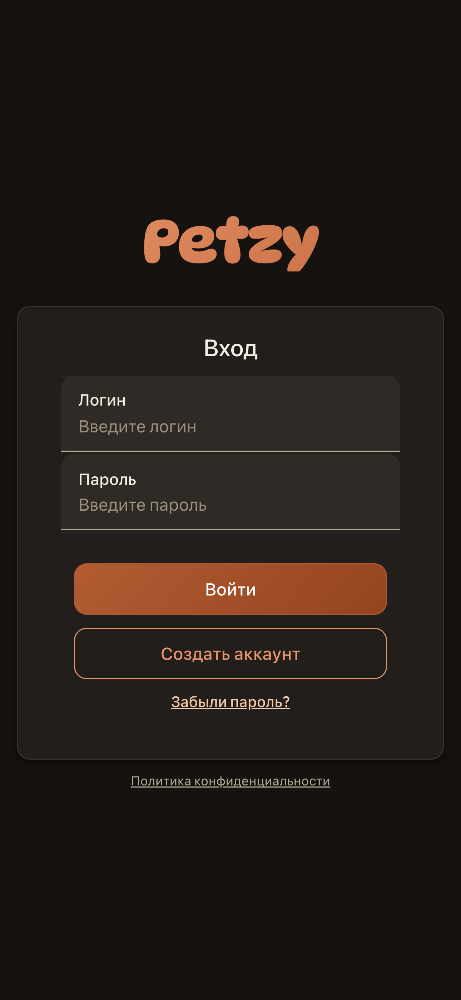 | 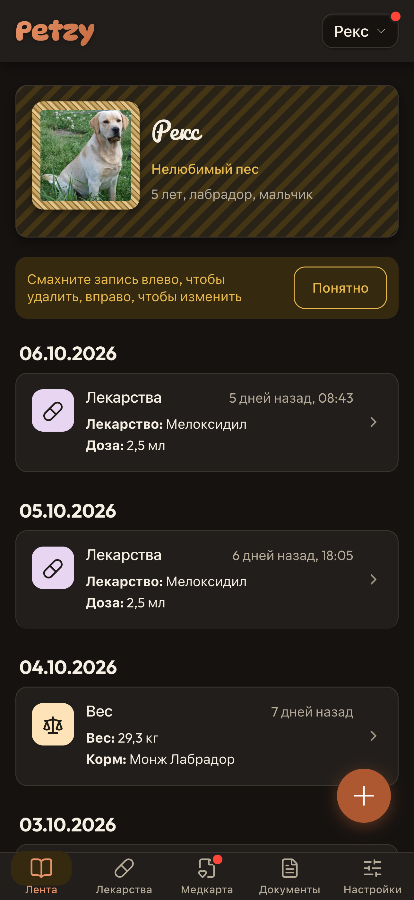 | 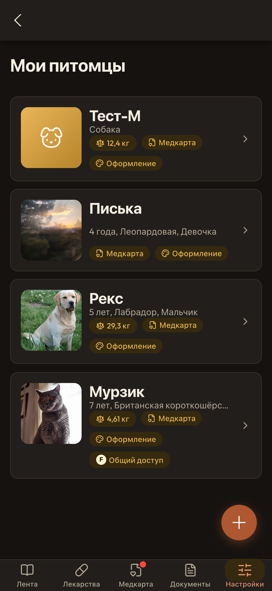 |
| **Sign in** | **Feed** | **My pets** |
| 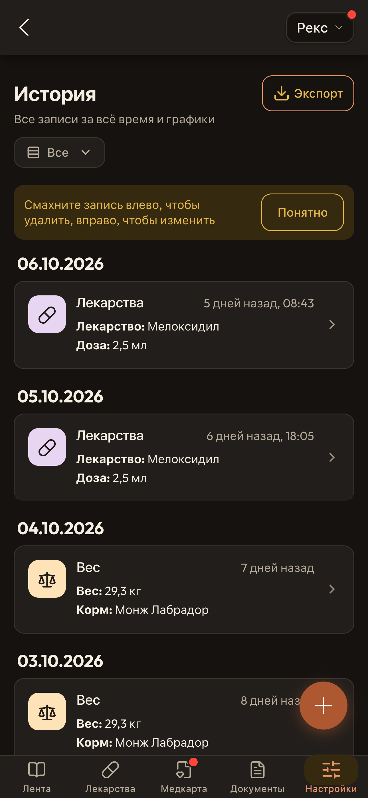 | 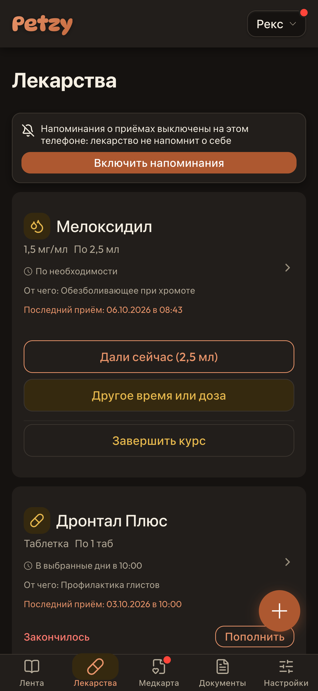 | 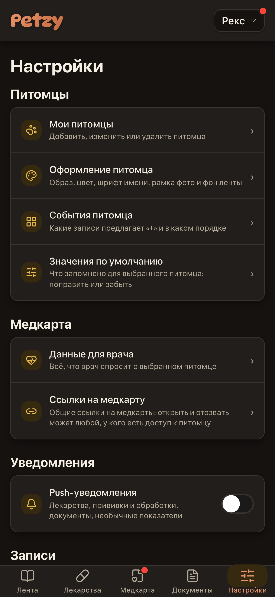 |
| **History** | **Medicines** | **Settings** |
| 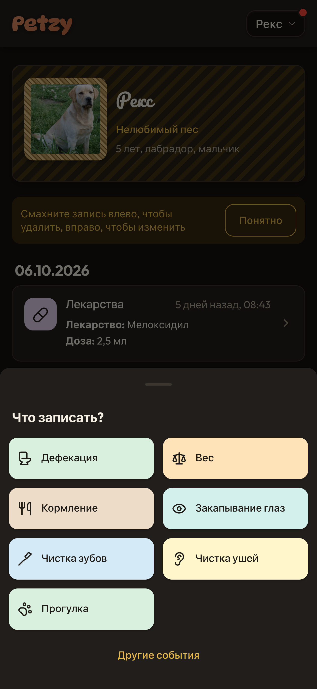 | 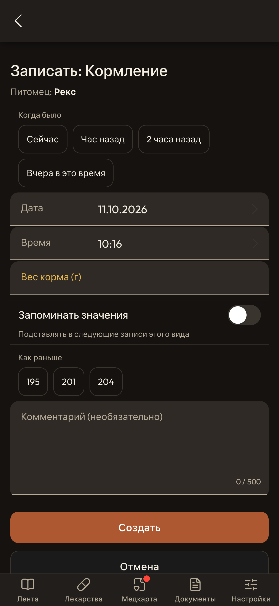 | 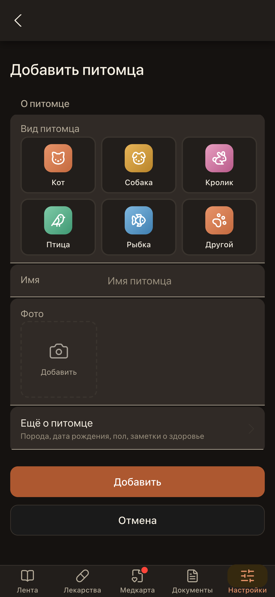 |
| **What to record?** | **Record: feeding** | **Add a pet** |
| 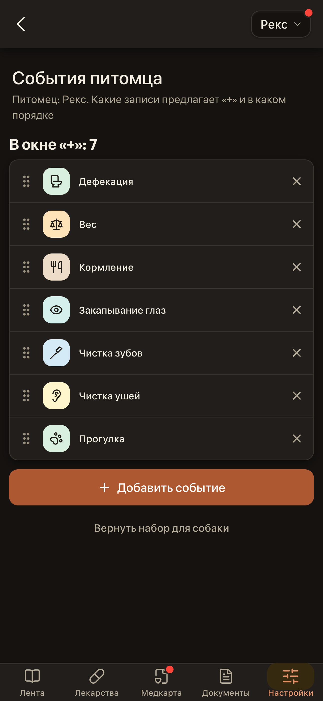 | 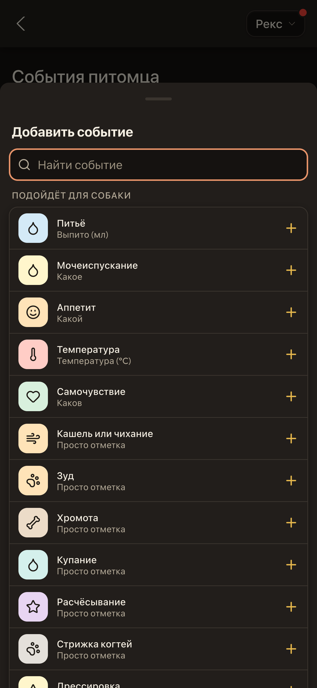 | 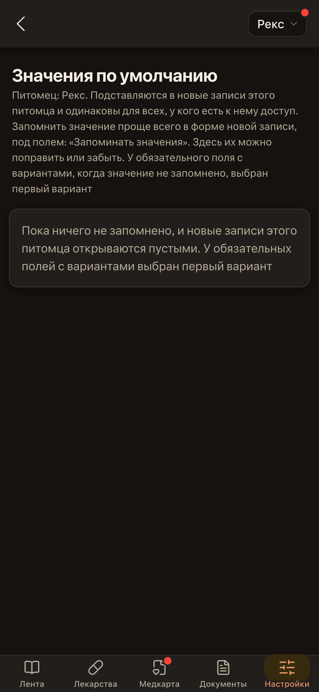 |
| **Pet events** | **Event catalogue** | **Defaults** |
| 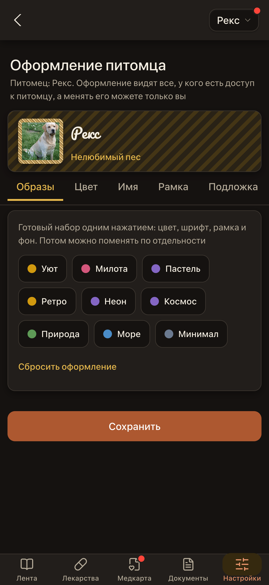 | 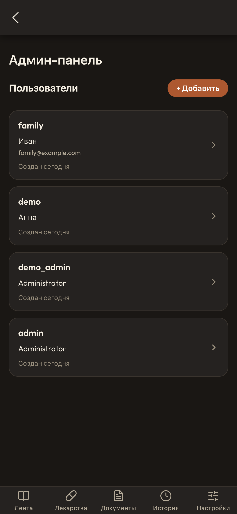 | |
| **Pet look** | **Admin panel** | |
| 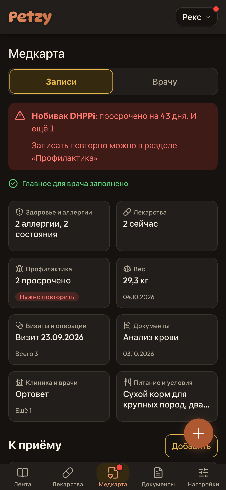 | 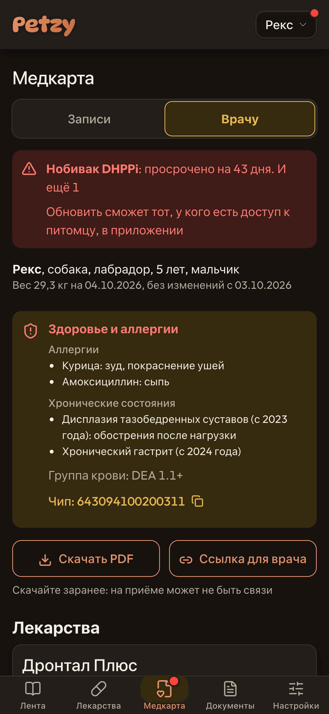 | 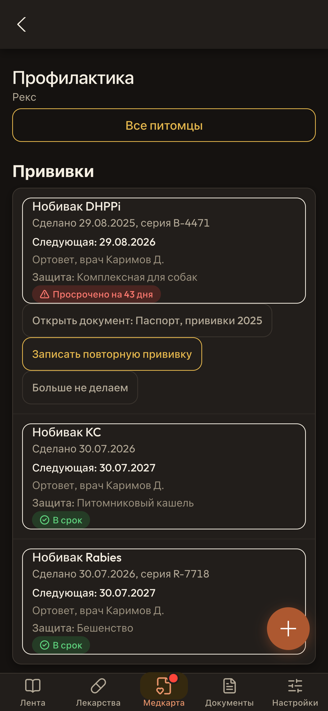 |
| **Medical card** | **Medical card: "for the vet"** | **Vaccinations and treatments** |

## How it works

```
phone (PWA) -> nginx -> Flask API -> MongoDB
                     |    |
                     |    +-> object storage (photos, documents, backups)
                     |
                     +-> MCP server -> the same API, with a personal token
```

Three parts move in production: the app, the API and the database. The rest of the stack sits beside them.

| Service | What it does |
| --- | --- |
| `db` | MongoDB 8.2, on `127.0.0.1:27017` only. |
| `web` | The API (gunicorn, with the configuration in `gunicorn.conf.py`), on `127.0.0.1:5001`. |
| `frontend` | Builds the app and puts it into a shared volume. |
| `nginx` | Serves the app and proxies `/api/` to `web`, on `127.0.0.1:3000`. |
| `reminders` | Sends the push reminders about doses, documents whose term is ending, and repeat vaccinations and treatments. |
| `backup` | A daily backup of the database into the bucket. |
| `mcp` | The MCP server for assistants. It publishes no port of its own and is reached at `/mcp` through nginx. |

The API is a Flask app with one blueprint per area: `auth`, `pets`, `users`, `account`, `personal_tokens`, `legal`, `version`, `events`, `medications`, `documents`, `push`, `export`, `medical_card`, `medical_share`, `vaccines`, `medical_records`, `sync`, `image_preview` and the OpenAPI docs blueprint. Request and response models are pydantic schemas in `web/schemas.py`; error codes and their Russian texts live in `web/errors.py`.

- **Backend:** Python 3.12, Flask, flask-pydantic-spec (validation and the OpenAPI specification), pymongo, gunicorn, Flask-Limiter, boto3 (Backblaze B2, S3 API), pywebpush, Pillow, Sentry.
- **Frontend:** React 18, TypeScript, Vite, antd-mobile, TanStack Query, React Router, React Hook Form with Zod, vite-plugin-pwa (Workbox, `injectManifest`).
- **Infrastructure:** Docker Compose, nginx, MongoDB, GitHub Actions (CI, deployment on a push to `master`).

Records are the spine of the app. An event type is a set of fields, and the catalogue holds 34 of them (`web/builtin_event_types.py`); the family adds its own types, and only the family that created them sees them. A record stores the value, the time as it was typed and the time zone it was typed in, which is why the history and the charts say the same thing on two phones in two zones.

The medical card is not a separate questionnaire. It is read from the records and the pet's profile when it is opened, and the PDF for the vet is rendered from the same data (`web/medical_card_pdf.py`, fpdf2 with the bundled DejaVu Sans).

## API

The reference is published at **https://petzy.duckdns.org/api/docs** (ReDoc), the specification at **/api/openapi.json** (OpenAPI 3.0.3). It describes the sign-in from a native app (tokens in the request body without an `Origin` header, `Authorization: Bearer`), the error format, the date and time conventions, uploads and the limits. The specification is assembled from the pydantic schemas of the routes and completed in `web/openapi_doc.py`; answers at runtime are checked against those schemas.

Which build is answering: **/version** (or **/api/version**), without signing in. It returns the commit the running thing was built from, and honestly empty fields when the run was not a deployment (`{"commit": "", "short": "", "known": false}`). The number goes into `.env` through `PETZY_BUILD_SHA`; nobody passes it by hand.

The MCP server for assistants lives in `mcp/petzy_mcp` and speaks five tools: `list_pets`, `list_event_types`, `add_event`, `get_history` and `get_medical_card`. It is reached at `/mcp` through nginx and takes no secrets of its own: every request carries a personal access token in the `Authorization` header, with one of four scopes (`pets:read`, `events:write`, `history:read`, `medical:read`).

## Configuration

`.env.example` lists every variable with a comment. The main ones:

| Variable | Default | What it does |
| --- | --- | --- |
| `MONGO_USER`, `MONGO_PASS`, `MONGO_DB` | none | The database. The root account is the one the backups use. |
| `MONGO_APP_USER`, `MONGO_APP_PASS` | none | The application's own account (read and write in its own database and in `limits`); the deployment creates it and sets the password on the server. Without it the application signs in as root. |
| `FLASK_SECRET_KEY`, `JWT_SECRET_KEY` | none | A long random value; the application refuses to start with the example one. `JWT_SECRET_KEY` falls back to `FLASK_SECRET_KEY`. |
| `ADMIN_USERNAME` | `admin` | The name of the admin account. |
| `ADMIN_PASSWORD_HASH` | none | The admin's password, set only as a bcrypt hash. There is no default value, and without a hash the application does not start. |
| `S3_ENDPOINT`, `S3_REGION`, `S3_BUCKET`, `S3_KEY_ID`, `S3_SECRET_KEY` | none | Object storage for every file and for the backups. |
| `SMTP_HOST`, `SMTP_PORT`, `SMTP_USER`, `SMTP_PASSWORD`, `SMTP_FROM` | none | Mail for password recovery; without it the application says that recovery goes through the admin. |
| `VAPID_PUBLIC_KEY`, `VAPID_PRIVATE_KEY`, `VAPID_CLAIMS_EMAIL` | none | Web Push. The pair comes from `python -m scripts.generate_vapid_keys`. |
| `REGISTRATION_ENABLED` | `true` | `false` closes registration. |
| `STORAGE_QUOTA_MB` | `2048` | Documents and scans per pet owner, in MB. |
| `SENTRY_DSN` | none | Errors, traces and profiles in Sentry; without it everything is off. |
| `PRIVACY_OPERATOR`, `PRIVACY_CONTACT_EMAIL`, `PRIVACY_SERVER_LOCATION` | none | Who processes the data, where to write, the country of the database server. All three are shown in the privacy policy. |
| `RATE_LIMIT_LOGIN` | `10` per minute | Wrong passwords from one address. A correct password is not counted. |
| `RATE_LIMIT_REGISTER` | `5` per hour | Accounts made from one address. Only successful sign-ups count. |
| `BACKUP_KEEP` | `3` | How many backups are kept, newest first. |
| `BACKUP_HOUR_UTC` | `0` | The hour of the day, UTC, to back up at. |

A bcrypt hash for the admin password:

```sh
python -c "import bcrypt; print(bcrypt.hashpw(b'your_password', bcrypt.gensalt()).decode())"
```

## Deployment

A push to `master` runs CI and the deployment to the server (`.github/workflows/deploy.yaml`). Documentation, screenshots and the four service workflows do not trigger it. The deployment first frees disk (fresh builds had left old images and the build cache behind until MongoDB stopped writing), then pulls, writes the secrets into the server's `.env`, rebuilds and restarts the stack. Deployments run one at a time. It can also be started by hand, for example after a secret has changed:

```sh
gh workflow run "Deploy to Server"
```

Repository secrets: `SERVER_PETZY_HOST`, `SERVER_PETZY_USER`, `SERVER_PETZY_SSH_KEY`, `S3_KEY_ID`, `S3_SECRET_KEY`, `VAPID_*`, `SMTP_*`, `SENTRY_DSN`. Set them with `gh secret set NAME`, which asks for the value. Repository variables (public): `PRIVACY_OPERATOR`, `PRIVACY_CONTACT_EMAIL`, `PRIVACY_SERVER_LOCATION`, set with `gh variable set NAME`.

The other workflows all run by hand:

- **Diagnose server:** containers, disk, nginx, which settings are given (never their values), the mail login, the backups, and on request a check of the restore.
- **Storage check:** the bucket and its keys.
- **Inspect DB:** the number of documents, no data.
- **Migrate events:** one-off data migrations.
- **Cleanup refresh tokens:** removes expired sessions.
- **Clean server disk:** shows what fills the server's disk (sizes by category, no paths) and, with `apply`, frees what the build can reproduce: unused images, the build cache, the old journal, the package cache. Volumes are left alone.

The repository is public, and so are the Actions logs: the workflows print counts and the fact of a thing's presence, never user data and never secrets.

## Backups

The `backup` service (`backup/Dockerfile`, `scripts/backup_to_s3.py`) dumps the database into the bucket once a day:

- it dumps it with `mongodump` into one gz archive and checks that the archive reads back (`mongorestore --dryRun`);
- it uploads it to `backups/mongo/<db>-YYYYMMDD-HHMMSS.archive.gz`, past the user files (`users/`) and the local runs (`dev/`), and compares the stored size;
- and only then does it delete everything except the newest `BACKUP_KEEP` (3) backups, every version of them.

A failed attempt keeps the old backups and is repeated an hour later. When the service starts and the newest backup is more than a day old, it backs up at once. Files (photos, documents, scans) are already in the bucket and are not part of the dump.

A backup right now:

```sh
docker compose run --rm backup python3 scripts/backup_to_s3.py --once
```

**Restore** (it overwrites the collections it restores; take the file name from the list the Diagnose workflow prints):

```sh
# 1. Download it into the current directory (or from the Backblaze web console)
docker compose run --rm -v "$PWD:/out" backup python3 -c "from web import storage; \
  storage._client().download_file(storage._bucket(), 'backups/mongo/<file>.archive.gz', '/out/b.archive.gz')"
# 2. Restore it into the running database
docker compose cp b.archive.gz db:/tmp/b.archive.gz
docker compose exec db mongorestore -u "$MONGO_USER" -p "$MONGO_PASS" --authenticationDatabase admin \
  --archive=/tmp/b.archive.gz --gzip --drop
```

To look at a backup without touching the live data, restore it under another name with `--nsFrom '<db>.*' --nsTo 'restored.*'` instead of `--drop`.

## Development

```sh
.venv/bin/python -m pytest tests          # backend, mongomock and moto, no network
.venv/bin/ruff check . && .venv/bin/ruff format --check .
cd frontend && npm run lint && npm run build
```

Git hooks run all of that for you: enable them once with `git config core.hooksPath .githooks` (see `CLAUDE.md`).

The browser checks are separate and need the local stand: `.venv/bin/python e2e/run.py [filter]` (Playwright, phone viewport). They are not part of `pytest` and not part of CI. `e2e/README.md` says what they cover.

| Path | What it holds |
| --- | --- |
| `web/` | The Flask API. One module per area: `app.py` (the app, blueprints, security headers, rate limits), `auth.py` (sign-in, registration, refresh, sign-out), `account.py` (mail, password, recovery by mail), `account_deletion.py` (passing a deleted owner's pets to the person they were shared with), `security.py` (tokens, sessions, access decorators), `pets.py` (pets, photos, sharing and invitations), `events.py` (records, event types, the feed, statistics), `builtin_event_types.py` (the built-in types and their order), `medications.py` (courses, doses, stock, nearest doses), `documents.py` (documents, scans, the quota), `medical_card.py`, `medical_card_pdf.py` (the PDF for the vet), `medical_records.py` (vaccinations, treatments, visits, operations), `medical_share.py` (the read-only link for a vet), `storage.py` (object storage, keys, signed URLs), `push.py` and `push_delivery.py` (Web Push), `export.py`, `users.py`, `mail.py` (SMTP), `validation.py` (the Russian validation messages), `trend_alerts.py` (notifications about unusual values), `legal.py` (the privacy policy and the consent), `observability.py` (Sentry), `openapi_doc.py` (the published API reference), `schemas.py` (the pydantic request and response models). |
| `frontend/src/` | The React app: `pages/` (one file per screen), `components/` (the shared pieces), `services/` (one file per API area), `hooks/`, `utils/`, `content/help.ts` (the help inside the app), `styles/globals.css` (the tokens), `sw.ts` (the service worker). |
| `mcp/` | The MCP server for assistants: the API client, the tools, the HTTP app and the stdio mode. |
| `nginx/` | The nginx of the app: `nginx.conf`, `nginx.conf.server`, `nginx.conf.external`, `security-headers.conf`. |
| `scripts/` | `dev_local.py`, the reminders, the backups, the migrations, the audits, the demo seeding. |
| `tests/` | The backend tests: `tests/stateless/` (no database) and `tests/stateful/` (mongomock, moto for S3). |
| `e2e/` | The browser checks of the interface (Playwright, needs the local stand, see `e2e/README.md`). |
| `.github/workflows/` | CI, the deployment, the service workflows. |

The interface text is Russian, and `AGENTS.md` holds the rules for it, the layout, the traps and the rails.

## License

MIT, © Alexander Blinov. See [LICENSE](LICENSE).
